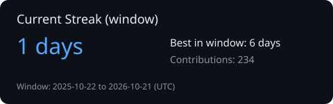

# Hello there, I’m Luca 👋

### Security Engineer · DevSecOps · Cloud Security · Platform Engineering · Building secure systems — not just CI/CD pipelines.

> **Welcome to the dark side. We have root access.**

I’m a Security Engineer focused on **cloud infrastructure security, DevSecOps, platform security, security automation, and observability** across Azure and AWS environments.

I enjoy working where **security, infrastructure, software engineering, and automation intersect** — especially where security can be engineered directly into platforms and developer workflows instead of becoming another approval step at the end.

My goal is simple:

> **Make the secure way the easiest way to build and operate software.**

---

## 🧭 At a Glance

| | |
|---|---|
| 🛡️ **Security** | Cloud Security · DevSecOps · Infrastructure Security · IAM · Detection & Response |
| ☁️ **Cloud & Platform** | Azure · AWS · Kubernetes · Terraform |
| 🔐 **Security Engineering** | Secrets Management · Least Privilege · Policy-as-Code · Security Guardrails |
| 🚚 **Software Delivery** | Secure CI/CD · Supply Chain Security · Artifact Security · Reusable Workflows |
| ⚙️ **Automation** | Python · Bash · PowerShell · Infrastructure & Security Automation |
| 📊 **Observability** | Splunk · ELK · Datadog · Prometheus · Grafana · Loki · Wazuh |
| 🌐 **Networking & Ingress** | Tailscale · Caddy · Private DNS · Cloudflare DNS-01 |
| 🤖 **AI Security** | Local LLMs · AI Gateways · Agent Governance · Shared Skills · Guardrails |
| 🧪 **Homelab** | Multi-server security lab with zero-trust networking, centralized secrets, observability, network detection and local AI |
| 🏗️ **Currently Building** | A public security engineering portfolio spanning cloud → CI/CD → supply chain → runtime → detection → AI |

I am a really curious guy, I like understanding **why systems are designed the way they are**, where the trust boundaries are, how they fail, why they fail, when they fail, what happens if I push this button 🔴

---

## 🏗️ Projects

### 🧪 Homelab

My homelab is where a lot of curiosity turns into actual engineering.

I use it to experiment with **security operations, network visibility, observability, infrastructure automation, zero-trust networking, CI/CD, distributed systems, identity, secrets management and local AI**.

Rather than treating it as a collection of self-hosted applications, I try to design it like a small production environment — with clear responsibilities, private connectivity, centralized secrets, centralized observability, CI validation, least-privilege integrations and consistent host security controls.

Every server ships its logs and metrics to **Cronus** for centralized monitoring, dashboards, alerting and correlation. **Fail2ban is enabled on every server** to provide host-level protection against repeated authentication and service abuse attempts.

Internal services are exposed through **Caddy**, which acts as the reverse-proxy and TLS termination layer for the homelab. Combined with **Tailscale** and internal DNS resolution, this gives services consistent HTTPS endpoints without exposing administrative interfaces directly to the public internet.

## 🖥️ Infrastructure

| Project / Host | Role | Status |
| --- | --- | :---: |
| **Cronus** | Security Operations & Observability Platform | 🟢 Active |
| **Athena** | Network Security & Telemetry | 🟢 Active |
| **Ares** | Private Infrastructure-as-Code & CI Platform | 🟢 Active |
| **Argus** | Edge Node & Self-hosted AI Platform | 🟢 Active |
| **Apollo** | Storage & Media Infrastructure | 🟢 Active |
| **`_agent-shared`** | AI DevSecOps Agent Governance Platform | 🟢 Active |
| **Windows GPU Worker** | On-demand AI Compute | NVIDIA RTX GPU · local inference workloads · centralized logs and metrics |

## 📊 Cronus — Security & Observability Platform

**Cronus** is a modular, self-hosted Docker Compose platform I built for **security operations, observability and infrastructure tooling**.

Instead of maintaining one large Compose file, the platform is split into domain-owned modules:

```text
cronus/
├── core/
├── security/
├── monitoring/
├── dev/
├── siem/
└── docker-compose.yml
```

The top-level Compose file brings those modules together while keeping each domain independently maintainable.

Individual capabilities can be enabled or disabled from the root layer without modifying the underlying service definitions.

That lets the same architecture scale from a relatively lean single-node deployment to a broader security operations platform.

### Live services

Cronus currently brings together:

`Prometheus` · `Grafana` · `Alertmanager` · `Loki` · `Vector` · `Promtail` · `InfluxDB`

alongside:

`CrowdSec` · `PostgreSQL` · `Portainer` · `Uptime Kuma` · `Watchtower`

Portainer is intentionally isolated behind a **restricted Docker socket proxy** rather than receiving unrestricted access to the Docker daemon.

Additional capabilities are staged in the repository and can be promoted when needed, including:

`Wazuh` · `Graylog` · `Velociraptor` · `Copilot` · `Shuffle`

The objective isn’t to run every security product at once.

It’s to have a platform where capabilities can be introduced deliberately as the architecture evolves.

### Security by design

I try to apply the same principles to the lab that I would expect from production infrastructure:

- secrets managed with **Doppler**
- centralized logs and metrics from every server
- **fail2ban enabled on every server**
- **Caddy reverse proxy with TLS termination**
- least-privilege connectors
- restricted Docker socket access
- dedicated service identities
- CI validation of Docker Compose configuration
- private administrative interfaces
- explicit service boundaries

```text
change
   ↓
CI validation
   ↓
Compose config check
   ↓
review
   ↓
deployment
   ↓
logs and metrics shipped to Cronus
   ↓
centralized monitoring and alerting
```

---

## 🛰️ Athena — Network Security & Telemetry

**Athena** is my self-hosted network security and observability stack, built with modular Docker Compose configurations.

Its role is to collect and enrich network, host and security telemetry before forwarding it to the central observability platform on Cronus.

Athena ships its logs and metrics to **Cronus**, and **fail2ban runs on the host as part of the standard security baseline**.

### Network visibility

Athena combines:

- **Zeek** for network metadata and protocol visibility
- **Suricata** for IDS alerts and network threat detection
- **NetAlertX** for device discovery and network presence monitoring

```text
Network Traffic
      │
      ├── Zeek
      │     └── protocol / connection metadata
      │
      ├── Suricata
      │     └── IDS / security alerts
      │
      └── NetAlertX
            └── device discovery / presence
```

### Logs & metrics

`Vector` · `Promtail` · `Alloy`

ship logs and events toward Loki, while Prometheus exporters expose:

- host metrics
- container metrics
- process metrics
- security metrics

Athena also includes operational tooling such as:

`Portainer` · `Glances` · `Watchtower` · `fail2ban`

### Separation of responsibilities

```text
        Athena
 Network / Host Telemetry
          │
          ├── Zeek
          ├── Suricata
          ├── NetAlertX
          ├── Vector
          ├── Promtail
          ├── Alloy
          ├── Exporters
          └── fail2ban
              │
              ▼
            Cronus
     Central Observability
              │
      ┌───────┼────────┐
      │       │        │
 Prometheus  Loki    Grafana
```

Athena focuses on **collection, host protection and visibility**.

Cronus handles centralized storage, dashboards, alerting and correlation.

> **Resistance is futile. Your logs will be centralized.**

---

## 🛠️ Ares — Private Infrastructure-as-Code Platform

**Ares** is my private, self-hosted Linux platform for **CI/CD, application hosting, automation, home infrastructure and engineering workloads**.

Everything is defined as code and deployed through Docker Compose, with services reachable privately over a **Tailscale tailnet** rather than exposed directly to the public internet.

Ares ships its logs and metrics to **Cronus**, and **fail2ban runs on the host** as part of the standard security baseline.

Internal applications use **Caddy as the reverse-proxy layer**, giving services consistent HTTPS endpoints while preserving the private-by-default network model.

The goal is to keep the environment production-shaped:

> reproducible infrastructure, private-by-default networking, centralized observability, controlled secrets and clear operating conventions.

### Compose-first architecture

A thin top-level `docker-compose.yml` assembles small, service-focused Compose files through `extends:` and `include:`.

Across the stack I try to keep the same conventions:

- private access through Tailscale
- Caddy-based reverse proxying and TLS
- one shared external `tailnet` Docker network
- predictable bind-mounted state
- secrets outside Git
- Doppler-backed secret delivery
- `no-new-privileges`
- restricted Docker socket access
- log rotation
- pinned and reviewed container images
- centralized logs and metrics shipped to Cronus
- fail2ban enabled on the host

### CI/CD & developer platform

Ares includes:

- **Gitea**
- **Gitea Actions runner**
- **GitHub self-hosted runner**
- a custom runner image I maintain myself

That runner includes tooling for real engineering workloads:

`Terraform` · `Vault` · `Node.js` · `Java` · `Playwright` · `JFrog CLI`

This gives me a place to test CI/CD patterns, infrastructure automation and security controls on my own hardware.

### Observability separation

Ares deliberately does not own its own monitoring plane.

Exporters, Vector and Promtail ship host and container telemetry to Cronus.

```text
Ares
 │
 ├── host metrics
 ├── container metrics
 ├── logs
 ├── service telemetry
 └── fail2ban events
        │
        ▼
Vector / Promtail / exporters
        │
        ▼
      Cronus
        │
 ┌──────┼──────┐
 │      │      │
Prom   Loki  Grafana
```

I prefer keeping workload and observability hosts separate so telemetry has an independent home.

### Internal services

Ares also hosts:

- **Home Assistant**
- **MQTT**
- internal development tools
- management services
- automation workloads

### AI-assisted operations

I use task-scoped AI agents and commands for:

- security review
- monitoring analysis
- change review
- PR risk assessment
- repository navigation
- operational troubleshooting

Secrets and destructive actions remain **human-gated**.

Repository-local guidance such as `AGENTS.md` and per-folder operating documentation defines how humans and AI agents are expected to work safely in the environment.

## 🛰️ Argus — Homelab Edge & AI Node

**Argus** is a self-hosted Debian edge node running a single-node Docker Compose stack for **observability, edge services and self-hosted AI**.

The stack uses one external `tailnet` network, with host-level **Caddy acting as the reverse proxy and TLS termination layer**.

Argus ships its logs and metrics to **Cronus**, and **fail2ban runs on the host** as part of the standard security baseline.

### Telemetry

Argus exports:

- node metrics
- container metrics
- process metrics
- fail2ban metrics

into the wider Prometheus/Grafana environment over the tailnet.

### Logging

`Vector` and `Promtail` ship host and Docker logs to Loki.

IDS feeds from Suricata and Zeek are normalized for a Wazuh agent, allowing network and host security events to participate in the broader detection pipeline.

### AI services

Argus runs:

`Open WebUI` · `OmniRoute` · `Redis` · `Ollama`

OmniRoute acts as an AI gateway and routes requests toward local inference endpoints.

### Hardened by default

Security controls include:

- Tecnativa Docker socket proxy
- Docker API ACLs
- `no-new-privileges`
- read-only mounts
- Watchtower
- CrowdSec
- fail2ban
- reviewed container images

### Private networking, reverse proxy & ingress

Argus uses:

- **Tailscale** for private networking
- **Caddy** as the reverse proxy and TLS termination layer
- **CrowdSec** for ingress security
- **Cloudflare DNS-01** for TLS certificates under `*.justsec.tech`

Caddy gives internal applications stable HTTPS endpoints while the underlying services remain private and reachable through the trusted network rather than being exposed directly.

Administrative services remain private.

### AI-agent ready

Argus also consumes the shared `_agent-shared/` governance layer so coding agents operate under the same safety rules used across infrastructure repositories.

---

## 🧠 `_agent-shared` — AI DevSecOps Agent Platform

`_agent-shared` is a framework-agnostic governance layer I built to make coding agents behave like a **consistent, cautious DevSecOps engineer** across repositories.

It supports:

`OpenCode` · `GitHub Copilot` · `Claude Code` · `Cursor` · `Codex`

The architecture is deliberately layered:

```text
Policy
  ↓
Instructions
  ↓
Skills
  ↓
Agents
```

### 📜 Policy

A single operating policy defines the baseline behavior expected from every agent:

- security-first defaults
- least privilege
- plan before apply
- explicit blast-radius analysis
- rollback expectations
- consistent review output
- secrets never read or printed
- destructive actions remain human-gated

### 📐 Domain standards

The platform includes **24 always-on instruction standards** covering:

`Azure` · `AWS` · `Terraform` · `Kubernetes` · `Docker` · `GitHub Actions` · `GitLab CI` · `Python` · `TypeScript` · `Security` · `Migrations` · `AI Agent Safety`

### 🧰 Shared skills

The platform currently contains **206 reusable skills**.

Each skill defines:

- when it should be used
- expected workflow
- validation commands
- safety constraints
- standard output contract

Domains include:

`Cloud Security` · `DevSecOps` · `Observability` · `Compliance` · `SBOM` · `Supply Chain Security` · `LLMOps` · `RAG` · `SAST` · `SCA` · `DAST` · `Infrastructure` · `Hardening`

Skills live once and are shared across agents rather than duplicated into individual personas.

### 🤖 Domain agents

Seven domain agents consume curated skill allow-lists:

`python` · `devsecops` · `cloud` · `migration` · `observability` · `typescript` · `ai`

The model is deny-by-default:

```text
"*": deny
```

Agents only receive access to explicitly assigned skills.

### 🔐 Safety as the product

Key principles include:

- no secret harvesting
- read-only helper scripts where possible
- plan-before-apply workflows
- explicit validation
- deny-by-default capability gating
- opt-in behavior
- human approval for sensitive or destructive actions

The goal isn’t to make agents maximally autonomous.

It’s to make them **predictable enough to trust with real infrastructure repositories**.

### 🧾 Provenance & governance

The repository tracks:

- extraction reports
- gap analysis
- asset inventories
- agent-to-skill mappings
- what was included, converted, rejected or skipped

MCP servers, plugins and hooks are treated as **reviewed integration notes**, not silently bundled tooling.

### 🔌 Framework-agnostic by design

The content is plain Markdown with Agent-Skills-style frontmatter.

A sync layer exposes the same governance and skills to different agent frameworks without duplicating the underlying content.

> **One source of truth for how AI agents are allowed to operate.**

And because coding alone is apparently no longer complicated enough:

> **It’s dangerous to code alone. Take this AI.**

## 🌐 Zero-Trust Networking

The homelab uses **Tailscale** as its private connectivity layer and **Caddy** as the reverse-proxy and TLS layer for internal services.

Administrative and internal services are not intended to be exposed directly to the public internet.

I use public domain names for consistency, while service resolution and access remain internal to the trusted network.

TLS certificates are handled through **Caddy**, including **Cloudflare DNS-01** where required, while **Doppler** provides centralized secrets management.

Every server ships its logs and metrics to **Cronus**, and every server runs **fail2ban** as part of the common host security baseline.

```text
Trusted Device
     │
     ▼
  Tailscale
     │
     ▼
   Caddy
Reverse Proxy
   + TLS
     │
     ├── Cronus
     ├── Athena
     ├── Ares
     ├── Argus
     └── Apollo
          │
          ├── logs and metrics
          └── fail2ban protection
                │
                ▼
              Cronus
```

The model is simple:

```text
Public Internet
      ✕
      │
      │ no direct administrative access
      │
Trusted Identity
      +
Tailscale Network
      ↓
Caddy Reverse Proxy
      +
TLS Termination
      ↓
Internal Services
      │
      ├── fail2ban on every server
      └── logs and metrics shipped to Cronus
```

This gives the environment a consistent service-access pattern:

```text
friendly hostname
      ↓
Caddy
      ↓
TLS
      ↓
private service
      ↓
Tailscale / internal network
```

## 🔬 Curiosity Drives a Lot of What I Build

A lot of what I know started with:

> **“I wonder what happens if I build this myself.”**

Which often turns into:

```text
build it
   ↓
break it
   ↓
debug it
   ↓
secure it
   ↓
monitor it
   ↓
automate it
   ↓
wonder why I started this at 11 PM
```

Some experiments become projects.

Some become automation.

Some become lessons about why production systems are designed the way they are.

And occasionally they become all three.

> **Resistance is futile. Your code will be refactored.**

---

## ⚙️ Technologies

### ☁️ Cloud & Infrastructure

`Azure` · `AWS` · `Kubernetes` · `Docker` · `Terraform` · `Linux` · `Tailscale` · `Caddy`

### 🔐 Security Engineering

`HashiCorp Vault` · `Doppler` · `SonarQube` · `Artifactory` · `OPA` · `Wazuh` · `Suricata` · `Zeek` · `CrowdSec` · `fail2ban`

### 🚚 CI/CD

`GitHub Actions` · `GitLab CI` · `Azure DevOps` · `Gitea Actions`

### ⚙️ Automation

`Python` · `Bash` · `PowerShell`

### 📊 Observability

`Splunk` · `ELK` · `Datadog` · `Prometheus` · `Grafana` · `Loki` · `Vector` · `Promtail` · `Alloy`

### 🤖 AI & Agent Engineering

`Ollama` · `Open WebUI` · `OmniRoute` · `Local LLMs` · `AI Agents` · `AI Gateways` · `Agent Skills`

> Tools change.
>
> Understanding **architecture, identity, trust, failure modes and security boundaries** lasts considerably longer.

---

## 📊 GitHub Stats

<p align="center">
  
  
</p>

<p align="center">
  
</p>

<p align="center">
  <sub>Generated automatically using GitHub Actions.</sub>
</p>

---

## 🚀 What You’ll Find Here

This GitHub is becoming a practical collection of work around:

**Cloud Security · DevSecOps · Platform Security · Secure CI/CD · Software Supply Chain · Detection Engineering · Observability · Security Automation · AI Security · Agent Governance**

The goal isn’t to demonstrate that I can configure individual tools.

It’s to understand and demonstrate **how secure systems are put together**.

**Building secure systems — not just CI/CD pipelines**

---

<p align="center">
  <strong>May the source be with you.</strong><br/>
  <sub>Always learning. Always building. Usually automating something that started as a manual task.</sub>
</p>